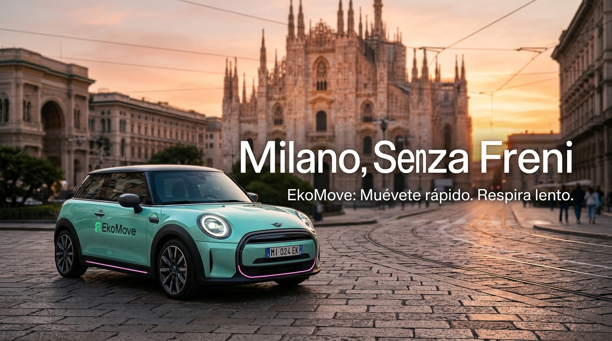

# 🚀 EkoMove: Estrategia Digital "Milano, Senza Freni"

**Reto Final - Curso de Marketing y Estrategia Digital (Nivel 3)**

Este repositorio contiene el proyecto de lanzamiento de la marca de carsharing eléctrico **EkoMove** en la ciudad de Milán. El objetivo principal era introducir la marca no solo como una opción de movilidad, sino como un estilo de vida sostenible y "Tech-Chic".

### 🔗 [👉 Haz clic aquí para ver la presentación interactiva completa](https://everest9957.github.io/campa-a_Estrategia_Digital_Ekomove/)

---

## 📖 El Proceso de Creación (Case Study)

Para el desarrollo de esta estrategia digital, se siguió un proceso estructurado en cuatro fases clave:

### 1. La Idea y el Contexto (Milán)
Se analizó el mercado de Milán, una ciudad con altos niveles de contaminación pero con un fuerte compromiso hacia la movilidad sostenible (Plan Urbano 2019). Se identificó una oportunidad: la competencia (Share Now, Zity) ofrece coches, pero EkoMove debía ofrecer **experiencias**.
*   **Concepto Creativo:** *"Milano, Senza Freni"* (Milán, sin frenos). Un concepto que juega con la rapidez de la ciudad y la fluidez de la movilidad eléctrica.
*   **Tono:** Moderno, visual, ecológico y muy alineado con la cultura de la moda milanesa.

### 2. Audiencias (Buyer Personas)
Se definieron dos arquetipos de clientes basados en datos demográficos y de comportamiento:
*   **Early Pioniere (25-35 años):** Creadores de tendencias, nativos digitales. Representada por **Giulia**, una diseñadora gráfica que busca estatus y experiencias.
*   **Pioniere Adopter (35-45 años):** Profesionales y familias. Representado por **Luca**, un consultor que busca flexibilidad y sostenibilidad sin ataduras.

### 3. La Estrategia Digital
Se diseñó un ecosistema digital bidireccional centrado en crear comunidad:
*   **Instagram:** Colaboración con micro-influencers y creadores locales.
*   **TikTok y YouTube:** Creación de "vídeo-píldoras" con los mejores planes de la ciudad para hacer en EkoMove.
*   **Spotify:** Playlists colaborativas para la comunidad.
*   **Landing Page:** Centro de operaciones web para la conversión y descarga de la App.
*   **Eventos Físicos:** "Aperitivo EkoMove" (networking) y "Fashion Week: Diseña tu coche" (concurso de vinilado).

### 4. Herramientas y Tecnologías Utilizadas
*   **Planificación y Análisis:** Simulación de Google Trends, SEMrush y Google Analytics.
*   **Diseño y Creación de Contenido:** Canva y Gemini AI (para la generación de imágenes y conceptos visuales).
*   **Desarrollo Web:** GitHub Pages para el despliegue del visor de la presentación.

---

## 🎨 Visualización del Proyecto

*(Nota: Para ver la presentación con todas las diapositivas y animaciones, visita el enlace de GitHub Pages en la parte superior).*

Si quieres ver una vista previa de la portada de la presentación, haz clic en el siguiente enlace:
👉 **[Ver documento PDF original](./Milano_Senza_Freni.pdf)**

---
*Proyecto realizado como parte del portfolio de Marketing Digital.*
